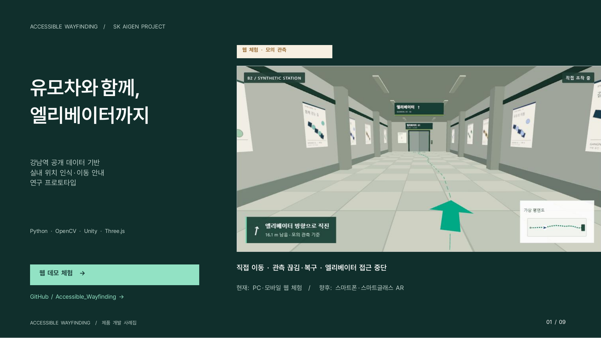

# 유모차 이동을 위한 지하철 엘리베이터 안내

**[웹 데모 바로 실행](https://jino-222.github.io/Accessible_Wayfinding/)** — 설치·로그인 없이 PC·모바일 브라우저에서 체험할 수 있습니다.

강남역 공개 데이터 기반 위치 인식 실험 및 경로 안내 프로토타입. 현재 제공 범위: 공개 이미지의 추정 결과, Unity 합성 RGB 실행 영상, 모의 관측을 사용하는 웹 직접 이동 체험.

## 프로젝트 개요

복잡한 다층 지하철역에서 유모차 이용자와 보호자가 엘리베이터 위치와 연결 동선을 확인할 수 있도록 구성한 연구 데모입니다.

- **공개 이미지 추정:** 강남역 B2 촬영 이미지에서 위치·방향을 계산하고 정답과 비교
- **합성 RGB 추정:** Unity 가상 역사 영상에서 추정한 위치를 안내 상태와 연결
- **웹 직접 이동:** 가상 카메라의 모의 관측으로 이동·끊김·복구·접근 중단을 조작
- **확장 목표:** 현장 시설·좌표 정합과 이용자 시험을 거쳐 스마트폰 AR 및 다른 역으로 확장

현재 휴대폰의 위치, 강남역의 실시간 통행·엘리베이터 운행 상태를 안내하는 서비스는 아닙니다.

## 최종 포트폴리오

[9쪽 PDF](portfolio/SK_AIGEN_Gangnam_Web_Portfolio.pdf) · [Overleaf LaTeX ZIP](portfolio/SK_AIGEN_Gangnam_Web_Overleaf.zip) · [계산 기준·검증 범위](portfolio/METHODS_KO.txt)

[](portfolio/SK_AIGEN_Gangnam_Web_Portfolio.pdf)

[직접 이동 체험](portfolio/preview/interaction.png) · [측정 성과](portfolio/preview/results.png)

## 실행

Python 3가 있다면 별도 패키지 설치 없이 실행할 수 있습니다.

```sh
python -m http.server 8080 --directory web/gangnam
```

브라우저에서 `http://localhost:8080`을 엽니다. `index.html`을 파일로 직접 열면 데이터 요청이 차단되므로 HTTP 서버를 사용하세요. 공개 웹 배포 후에는 PC·모바일 브라우저에서 같은 화면을 이용할 수 있습니다. 현재 로컬 환경에서 확인한 반응형 화면은 360·390·430·1280 CSS px입니다. 실제 휴대폰 하드웨어 검수와 외부 사용자 평가는 별도입니다.

## 직접 이동하기

`00 직접 이동`에서 `이동 시작`을 누릅니다. 화면 버튼은 한 번 누르면 0.6 m, 길게 누르면 연속 이동합니다. 화면을 누른 뒤 방향키 또는 WASD로 움직이고 Q/E로 회전할 수도 있습니다. 화면 드래그는 시선을 회전합니다. 벽과 복도 끝에는 체험용 이동 경계가 있습니다.

- `위치 인식 끊기`: 방향·거리·모의 위치를 즉시 숨깁니다. `위치 인식 복구` 후 새 관측 3개를 받아 현재 지점에서 재개합니다.
- `엘리베이터 접근 중단`: 안내와 도착 판정을 중단합니다. 접근 재개 후에도 위치를 다시 확인합니다.
- `일시정지`, 탭 전환, 브라우저 비활성화: 이동 입력과 안내를 정지합니다. 돌아온 뒤 `계속 이동`을 누릅니다.
- `체험 기록 저장`: 조작 이력과 최종 상태를 JSON으로 내려받습니다. 위치 인식 정확도 자료가 아닙니다.

직접 이동의 위치는 **가상 카메라 좌표에서 만든 모의 관측**입니다. RGB 위치 추정과 실시간 휴대폰 AR을 실행하지 않습니다. 3D 렌더링은 로컬에 포함된 Three.js 0.180.0을 사용하며 WebGL 2가 필요합니다. 추가 CDN·계정·카메라 권한은 없습니다.

## 합성 RGB 위치 추정 실행 보기

`01 실행 영상`에서 정상 이동(약 37초), 상실·복구(약 40초), 접근 중단(약 15초)을 재생합니다. `전체 과정`은 세 실행을 편집한 60초 영상입니다. 영상 아래의 원자료와 [Unity 실행·직접 조작 안내](docs/WALKTHROUGH.md)에서 계산 기준과 재현 절차를 확인할 수 있습니다.

공개 강남역 자료에서 참고한 것은 이동 축입니다. 복도·엘리베이터·안내판의 형태와 치수는 합성 설정이며 현재 강남역의 정확한 재현은 아닙니다.

## 나머지 화면 체험

1. **영상 기반 접근**에서 `위치 확인 예시`와 `접근 지점 예시`를 누릅니다. 원본 사진 옆에 실제 계산한 위치와 등록 동선을 표시합니다. 기본 카메라 55의 관측 32는 접근 지점 부근으로 추정한 사례입니다.
2. `위치 상실 주입` → `관측 재개` → `다음 관측`을 차례로 누릅니다. 서로 다른 관측 3개를 확인하기 전에는 다음 안내를 보류합니다. 이미 목적지를 지난 기록 영상이면 `선택 경로와 다른 구간`이 표시될 수 있습니다.
3. 출발점·목적지를 바꾸고, `확인된 폭만 허용`을 켭니다. 폭 자료가 없으므로 경로를 표시하지 않습니다. 영상의 촬영 방향과 위치는 선택에 맞춰 생성되지 않습니다.
4. **출입·층 이동**에서 출구와 방면을 고릅니다. `층 이동 체험` 후에는 도착층을 다시 확인해야 합니다. `역삼 방면 내부 중단` 등 시설 중단 조건을 바꾸면 등록된 경로가 사라지는지 확인할 수 있습니다.
5. **성능 살펴보기**에서 성공·실패 관측을 비교합니다. 선별된 12장은 사례 탐색용이고, 성능 수치는 전체 450장 평가에 근거합니다.

## 구현 범위

| 화면 | 데이터와 동작 | 해석 범위 |
| --- | --- | --- |
| 직접 이동 | Three.js 가상 복도, 키보드·터치 이동, 모의 관측·상태 전환 | 사용자 조작과 안내 동작 시험. 영상 인식 성능 시험 아님 |
| 실행 영상 | 합성 지도 108장, 별도 시점의 가상 이동 RGB → RootSIFT/PnP → 안내 상태 | 동일 합성 장면에서의 연결 동작, 실시간 휴대폰 AR·현장 시험 아님 |
| 영상 기반 접근 | 지도용 촬영 위치 3개·동선 2개, 별도 test 영상 67장, SIFT–LightGlue–PnP 추정값 | B2의 짧은 관측 구간. 엘리베이터 탑승·현재 호기 미확인 |
| 출입·층 이동 | 공식 출입 동선을 요약한 9개 지점·8개 유향 연결, 합성 관측 | 1·10번 출구 측에서 2호선 양방면까지의 연결 순서. 실측 평면도 아님 |
| 성능 살펴보기 | 공개 validation 중 한 촬영 세션 450장, 두 매칭 방식 비교 | 이미 검토한 평가자료의 재사용 비교. 독립적인 숨김 시험 아님 |

웹은 빌드 과정 없이 HTML/CSS/JavaScript와 포함된 Three.js 모듈로 실행하고, 위치 인식과 평가 코드는 Python으로 제공합니다. AI 역할은 사전학습 LightGlue의 영상 특징 대응입니다. 모델을 새로 학습하지 않았으며, 경로 계산·위치 상태 전환은 명시적인 규칙으로 구현했습니다.

## 결과와 남은 문제

| 450장 전체 분모 | RootSIFT 최근접 매칭 | 사전학습 LightGlue |
| --- | ---: | ---: |
| 위치 0.5 m·방향 5° 이내 출력 | 180/450 (40.0%) | 203/450 (45.1%) |
| 품질 기준을 통과한 위치 후보 | 249/450 | 329/450 |
| 수용 후보 중 위치 오차 5 m 초과 | 91/249 | 113/329 |
| CPU 질의 처리시간 중앙값 | 약 0.42초 | 약 1.99초 |

같은 450장에서 오차 기준을 충족한 이미지가 23장 늘었지만 처리시간도 증가했습니다. 처리시간에는 질의·검색·지도 캐시 준비 비용을 양쪽에 포함하고, 오프라인 모델·지도 초기 로딩은 제외했습니다. 도착 성공률이나 실시간 휴대폰 성능을 뜻하지 않습니다.

정확한 출력은 늘었지만 큰 오인식도 남았습니다. 따라서 위치 출력과 안내 허용을 분리했습니다. 동선에서 3 m 이내인지, 연속 관측이 일관되는지 검사하며 실패하면 안내를 보류합니다. 이 규칙이 현장 안전성을 보장하거나 오인식을 모두 제거한다는 뜻은 아닙니다.

추가 test 67장은 정답이 없어 정확도를 계산하지 않습니다. 품질 통과 49/67을 정확도로 표현하지 않습니다. 출구·층 이동 도식과 공개 영상 좌표의 전체 정합도 아직 확인하지 못했습니다.

## 합성 이동 실험

| 시나리오 | 0.5 m·5° 이내 / 모든 관측 | 최종 상태 |
| --- | ---: | --- |
| 정상 이동 | 68/69 | 접근 지점 도착 |
| 영상 상실·복구 | 70/76 | 안내 중단·재확인 후 도착 |
| 접근 중단 | 29/29 | 위치는 인식해도 경로 안내 중단 |

같은 합성 장면의 서로 다른 시점·높이를 사용했습니다. 고유 안내판·포스터가 매칭을 돕는 조건입니다. 실제 강남역 평가 정확도와 합치지 않습니다. 실행 조건과 재현 절차는 [실행 안내](docs/WALKTHROUGH.md)를 참고하세요.

## 검사와 재현

```sh
node --test tests/gangnam-demo.test.mjs tests/gangnam-corridor.test.mjs tests/gangnam-walk.test.mjs tests/gangnam-explorer.test.mjs
node scripts/audit_gangnam_release.mjs
```

웹 로직 검사 30개, Python 기하·위치 추정 검사 24개, 공개 이미지 82개와 실행 자산의 해시 검증을 제공합니다. Python 위치 인식 재현과 평가 기준은 [재현 안내](docs/REPRODUCE.md)와 [검증 범위](docs/VALIDATION.md)에 정리했습니다.

## 자료·라이선스·다음 단계

- NAVER LABS [Gangnam Station 공개 자료](https://www.visuallocalization.net/datasets/): 2019년 촬영. 개별 원본 사진의 바이트를 유지하고 출처와 [원 라이선스](web/gangnam/assets/naver-originals/LICENSE.txt)를 동봉했습니다. CC BY-NC-ND 4.0 modified 조건은 자체 코드와 별도입니다. 이미지 위 AR 합성본, 전체 특징 지도, 전체 원자료는 배포하지 않습니다.
- [서울교통공사 엘리베이터 목록](https://www.data.go.kr/data/15044261/fileData.do), [KRIC 공개 이동 경로](https://station.kric.go.kr/): 시설과 연결 순서를 대조했습니다. KRIC 안내도 이미지는 재배포하지 않습니다.
- 선행 AR 사례: NAVER LABS [강남역 복층 AR 연구·데모](https://www.naverlabs.com/blogDetail?seq=33849), [코엑스 네이버 지도 AR 안내](https://naverlabs.com/en/blogDetail?seq=34091). 기존 실내 위치 인식 기술의 유모차 이동 안내 적용 가능성 검토.
- 후속 개발 목표: 강남역 현장 좌표·현재 호기·통행 조건 확인 → 휴대폰 AR 연결·유모차 이용자 시험 → 길찾기 시간·잘못된 진입·복구 경험 측정 → 다른 역의 등록·갱신 절차 검증. 전 지하철 적용과 스마트글래스는 장기 확장 방향.

자체 코드: MIT. 데이터·글꼴·제3자 자료의 이용 조건은 [THIRD_PARTY_NOTICES.txt](THIRD_PARTY_NOTICES.txt)를 따릅니다. 본 프로젝트는 자료 제공기관의 공식 서비스 또는 인증을 의미하지 않습니다.
